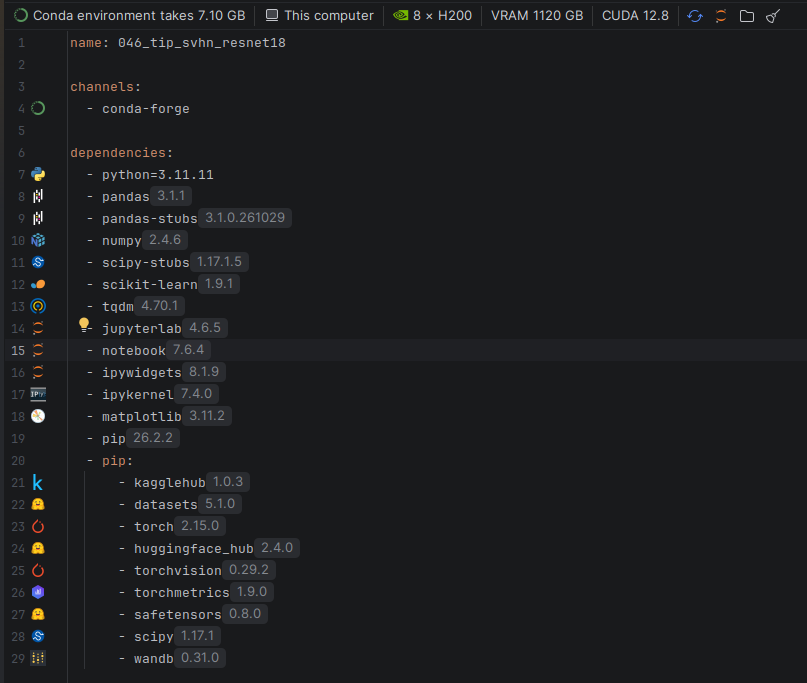
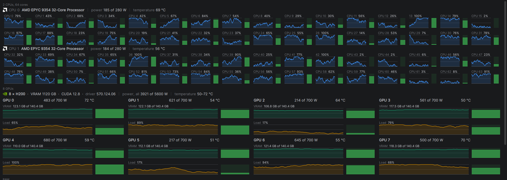

# Cobra torch - IntelliJ Plugin

<p align="center"></p>

The Cobra torch logos (`logo.png` and the plugin icon) were generated with ChatGPT.

# What it can do
## Conda env file
- Logos of frameworks
- Connect to remote machine via ssh and install env there
- See the gpu/cuda version both local/remote
 
## Yupiter & Python
- Logos of frameworks when import

## System monitor
- Entire computer system info


## How to build
```sh
./gradlew build    # Windows: gradlew.bat build
```
# How to install
Find file:

build/distributions/cobra-torch-<version>.zip

Settings | Plugins | Install Plugin from Disk


