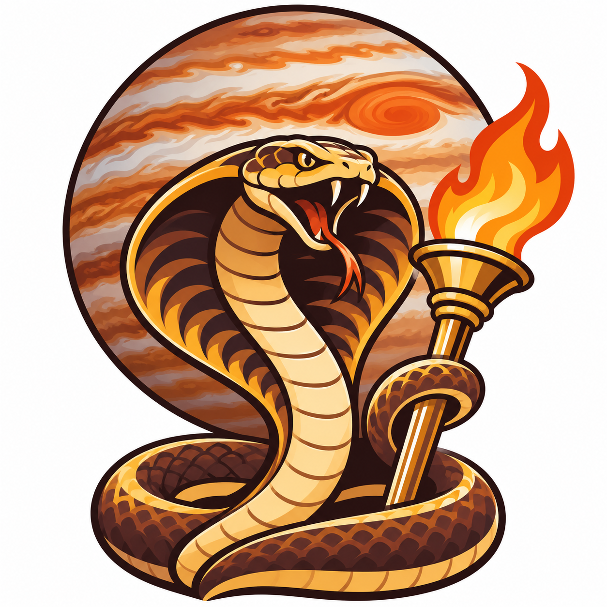
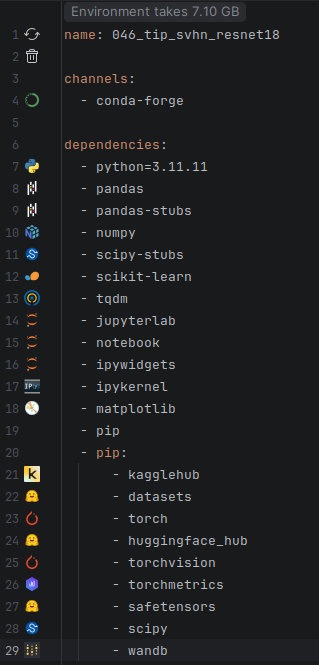
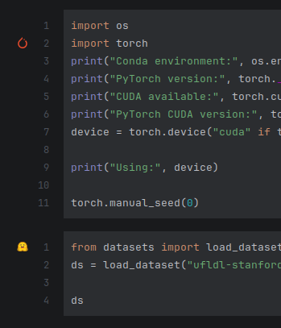
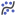
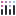
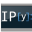
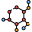
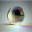
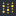

# Cobra torch - IntelliJ Plugin

<p align="center"></p>

The Cobra torch logos (`logo.png` and the plugin icon) were generated with ChatGPT.

# What it can do
 

## How to build
```sh
./gradlew build    # Windows: gradlew.bat build
```
# How to install
Find file:

build/distributions/cobra-torch-<version>.zip

Settings | Plugins | Install Plugin from Disk

| Logo | Dependencies |
|:---:|---|
|  | `python` |
|  | `numpy` |
| <picture><source media="(prefers-color-scheme: dark)" srcset="src/main/resources/icons/packages/pandas_dark.svg"></picture> | `pandas`, `pandas-stubs` |
|  | `scipy`, `scipy-stubs` |
|  | `scikit-learn` |
| <picture><source media="(prefers-color-scheme: dark)" srcset="src/main/resources/icons/packages/statsmodels_dark.svg"></picture> | `statsmodels` |
|  | `lightgbm` |
|  | `matplotlib`, `matplotlib-base` |
| <picture><source media="(prefers-color-scheme: dark)" srcset="src/main/resources/icons/packages/plotly_dark.svg"></picture> | `plotly` |
|  | `pillow` |
|  | `tqdm` |
|  | `openpyxl` |
|  | `cairosvg` |
|  | `jupyter`, `jupyterlab`, `notebook`, `ipywidgets` |
|  | `ipython`, `ipykernel` |
|  | `gradio` |
|  | `torch`, `pytorch`, `pytorch-cuda`, `pytorch-gpu`, `torchvision`, `torchaudio`, `torchao` |
|  | `torchmetrics` |
|  | `triton` |
|  | `liger-kernel` |
|  | `transformers`, `datasets`, `huggingface-hub`, `safetensors`, `tokenizers`, `accelerate`, `peft`, `trl`, `diffusers`, `evaluate`, `timm` |
|  | `sentence-transformers` |
|  | `vllm` |
|  | `llmcompressor`, `llm-compressor` |
|  | `outlines` |
| <picture><source media="(prefers-color-scheme: dark)" srcset="src/main/resources/icons/packages/eleutherai_dark.svg"></picture> | `lm-eval` |
|  | `transformer-lens` |
|  | `beir` |
|  | `kagglehub`, `kaggle` |
|  | `wandb` |

The Anaconda, NVIDIA, Intel, AMD and package logos are trademarks of their respective owners and are shown only to identify
the software. Cobra torch is not affiliated with, endorsed by or sponsored by any of them.
